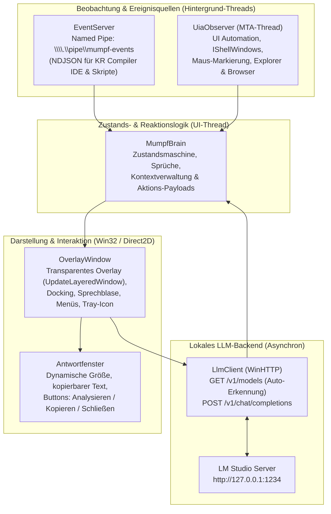

# Mumpf für Windows 11 – Technische & Benutzer-Dokumentation

**Projekt:** Mumpf Windows-11-Helferlein (`mumpf.exe`)  
**Technologie:** Natives C++20, Win32 API, Direct2D, DirectWrite, WIC, Windows UI Automation (UIA), Windows Shell COM, WinHTTP  
**Arbeitsverzeichnis:** `H:\mumpf_for_Windows` *(strikt ohne Schreibzugriffe, Caches oder temporäre Dateien auf `C:`)*

---

## 1. Überblick

**Mumpf** ist ein leichtgewichtiges, natives Windows-11-Desktop-Helferlein, das als per-pixel transparentes Overlay am Rand des aktiven Fensters sitzt, den Arbeitskontext beobachtet und bei Bedarf gezielt unterstützt — ohne den Tastaturfokus der aktiven Anwendung zu stehlen.

Die Kombination aus **sofortigen, handgeschriebenen Reaktionen** (0 ms Latenz, konsistenter Humor) und einem **lokalen LLM-Backend über LM Studio** (automatische Erkennung des geladenen Modells) ermöglicht sowohl blitzschnelle visuelle Rückmeldungen als auch fundierte Erklärungen, Zusammenfassungen und Datei-Analysen auf Klick.

---

## 2. Systemarchitektur

Mumpf ist in vier klar getrennte Schichten aufgebaut, die über eine thread-sichere Event-Queue (`WM_APP + 1`) miteinander kommunizieren:



---

## 3. Funktionsumfang im Detail

### 3.1 Transparentes Overlay, Docking & Bedienung
* **Kein Fokus-Klau:** Das Hauptfenster nutzt `WS_EX_LAYERED | WS_EX_TOPMOST | WS_EX_TOOLWINDOW | WS_EX_NOACTIVATE` und `MA_NOACTIVATE`.
* **Alpha-Hit-Testing:** Klicks außerhalb der sichtbaren Pixel von Mumpf werden über `WM_NCHITTEST` (`HTTRANSPARENT`) direkt an die darunterliegende Anwendung durchgereicht.
* **Automatisches Fenster-Docking:** Mumpf folgt dem aktiven Vordergrundfenster über `SetWinEventHook` (`EVENT_SYSTEM_FOREGROUND`, `EVENT_OBJECT_LOCATIONCHANGE`) sowie einen 200-ms-Fallback. Über `DwmGetWindowAttribute(DWMWA_EXTENDED_FRAME_BOUNDS)` dockt er exakt an der sichtbaren Fensterkante an und gleitet mit `running-left` / `running-right` herüber.
* **Drag & Drop:** Mumpf kann mit gedrückter linker Maustaste frei auf dem Bildschirm verschoben werden (deaktiviert Auto-Docking bis zur Reaktivierung im Tray-Menü).
* **System-Tray-Menü (Rechtsklick auf Mumpf oder Tray-Icon):**
  * *Demo: KR Build-Zyklus abspielen*
  * *Am aktiven Fenster andocken* (Ein/Aus)
  * *Spontane LLM-Sprüche (alle 2 Min.)* (Ein/Aus, standardmäßig aktiv)
  * *Stummschalten* (Ein/Aus)
  * *Mumpf beenden*
* **Dynamisch wachsende Sprechblase:** Die Höhe der Sprechblase wird per DirectWrite (`IDWriteTextLayout::GetMetrics`) exakt an die Textlänge angepasst und wächst nach oben über Mumpf mit, sodass kein Text abgeschnitten wird.
* **Spontane LLM-Sprüche im Leerlauf (alle 2 Minuten):** Steht Mumpf 2 Minuten lang ungenutzt im Leerlauf (kein Antwortfenster offen, nicht stummgeschaltet), fragt er automatisch dein aktuell geladenes Modell in LM Studio — im Wechsel nach einem **flachen Witz**, einem **kurzen Praxis-Tipp / Shortcut** oder einem **lockeren Spruch** passend zum gerade genutzten Programm. Mumpf zeigt den Text **10 Sekunden lang** in der Sprechblase und spielt dabei **10 Sekunden lang durchgehend** seine Animation (`Waving` bei Witz/Spruch, `Review` bei Tipp) ab.

### 3.2 Entwickler-IDEs & KR Compiler IDE
* **Automatische IDE-Erkennung:** Erkennt **KR Compiler IDE**, **Antigravity IDE**, **Codex**, **VS Code** (`Code.exe`) und **Visual Studio** (`devenv.exe`) anhand von Prozessname und Fenstertitel.
* **KR Compiler IDE Build-Zyklus (Named Pipe):**
  * `build_started` → Pose `running`, kurzer Kommentar zum Build-Start.
  * `diagnostic` (Warnungen) → 1. Warnung: `review`, 2. Warnung: `waiting`.
  * `build_finished` (`success: false`) → Pose `failed`, Spruch (*„Bei den Warnungen wollt ich noch höflich sein.“*). Klick auf Mumpf zeigt den ersten relevanten Compilerfehler (Datei, Zeile, Meldung) und holt live einen Lösungsvorschlag von LM Studio.
  * `build_finished` (`success: true`, 0 Warnungen) → Pose `jumping`, Spruch (*„Null Warnungen. Jetzt kann ich wieder atmen.“*).

### 3.3 Systemweite Text-Markierung (alle Anwendungen)
* **Erkennung:** Sobald in einer beliebigen Anwendung Text per Maus-Drag (`> 12 px`) markiert wird, liest Mumpf die Auswahl zuerst per Windows UI Automation (`IUIAutomationTextPattern::GetSelection`) und nutzt für Electron-/Chromium-Apps (z. B. Antigravity IDE, VS Code, Browser, Notepad++) einen zerstörungsfreien Clipboard-Fallback (vorheriger Zwischenablage-Text wird gesichert und sofort wiederhergestellt).
* **Aktionsmenü auf Klick:**
  * *Erklären (kurz & verständlich)*
  * *Zusammenfassen*
  * *Code / Fehler analysieren*
  * *Auf Deutsch übersetzen*
  * *Eigene Anweisung eingeben...* (öffnet ein kompaktes Eingabefeld für freie Prompts)
  * *Verwerfen*
* **Fokus-Rückgabe:** Nach Abschluss einer Aktion oder dem Schließen des Antwortfensters gibt Mumpf den Fokus sofort an das vorherige Fenster zurück, sodass unmittelbar weiter markiert werden kann.

### 3.4 Windows Explorer Integration
* **Dateimarkierung (`IShellWindows` / `IShellView` inkl. Windows-11-Explorer-Tabs):** Sobald im Windows Explorer (`CabinetWClass`) eine Datei oder ein Ordner markiert wird, ermittelt Mumpf den aktuell sichtbaren Tab zuverlässig über `IShellView::GetWindow` + `IsWindowVisible` (auch bei mehreren offenen Tabs), liest den vollständigen Pfad direkt über die Windows Shell API aus und bietet per Klick folgende Aktionen:
  * *Eigenschaften anzeigen (+ LLM-Analyse)* — zeigt Name, Pfad, Typ, Größe, Erstellt/Geändert und Attribute im kopierbaren Fenster mit zusätzlichem Button **„Mit LLM analysieren“**.
  * *Direkt mit LM Studio analysieren* — übergibt Eigenschaften sowie bei lesbaren Text-/Code-/Log-/Config-Dateien die ersten 2.000 Zeichen Inhalt an LM Studio.
  * *Öffnen* — startet die Datei über `ShellExecuteW`.
  * *Kopieren nach...* / *Verschieben nach...* — öffnet den Windows-Ordnerauswahl-Dialog (`IFileDialog` mit `FOS_PICKFOLDERS`) und führt die Operation sauber über `SHFileOperationW` aus.
  * *Löschen (Papierkorb)* — löscht sicher in den Papierkorb (`FO_DELETE` + `FOF_ALLOWUNDO` inkl. Windows-Bestätigung).
* **Kopierdialoge (`OperationStatusWindow`):** Werden sowohl im Vordergrund als auch **im Hintergrund** erkannt. Bei einem Zeitsprung von Sekunden/Minuten auf Stunden/Tage reagiert Mumpf (*„Weck mich, wenn die Schätzung erwachsen ist.“*), beim Abschluss winkt er.
* **Windows-Fehlerdialoge (`#32770`):** Liest Dialogtitel und -text per UIA aus und bietet per Klick eine verständliche Zusammenfassung über LM Studio.

### 3.5 Internetbrowser-Integration
* **Unterstützte Browser:** Google Chrome, Microsoft Edge, Firefox, Brave, Opera und Vivaldi.
* **Browser-Aktionsmenü auf Klick (ohne Textmarkierung):**
  * *Aktuelle Seite zusammenfassen*
  * *Wichtigste Punkte (Stichpunkte)*
  * *Seiteninhalt auf Deutsch erklären*
  * *Frage zur aktuellen Seite stellen...*
  * *Seitentitel kopieren*
* Der sichtbare Seiteninhalt wird über UI Automation (`UIA_DocumentControlTypeId` / `TextPattern` mit Text-Element-Fallback) ausgelesen und an LM Studio übergeben.

### 3.6 Lokales LLM-Backend (LM Studio) & Antwortfenster
* **Automatische Modellerkennung:** Bei `"llm_model": "auto"` fragt Mumpf vor der Anfrage `GET /v1/models` ab, überspringt Embedding-Modelle und nutzt automatisch das aktuell in LM Studio geladene Chat-/Reasoning-Modell.
* **Reasoning-Unterstützung:** Großzügiges Receive-Timeout (`90 s`) und `max_tokens: 600` für lokale Reasoning-Modelle (z. B. `google/gemma-4-e2b` oder `phi-3-mini-4k-instruct`).
* **Dynamisches Antwortfenster:** Passt seine Höhe automatisch per `DrawTextW(..., DT_CALCRECT)` an die Antwortlänge an (bis max. 60 % Bildschirmhöhe, darüber mit Scrollbar). Der Text ist direkt markierbar (`Strg+C`), zusätzlich stehen die Buttons **„Mit LLM analysieren“** (bei Dateieigenschaften), **„Kopieren“** und **„Schließen“** bereit.

---

## 4. Named-Pipe-Protokoll (`\\.\pipe\mumpf-events`)

Externe Anwendungen (wie die **KR Compiler IDE**, Build-Skripte oder CLI-Tools) können jederzeit UTF-8-kodierte **NDJSON-Zeilen** (eine JSON-Zeile pro Ereignis) an die Windows Named Pipe `\\.\pipe\mumpf-events` senden.

### Unterstützte Event-Typen

| `type` | Beschreibung | Relevante Felder |
|---|---|---|
| `build_started` | Startet Build-Beobachtung (`running`) | `source`, `target` |
| `diagnostic` | Meldet Compiler-Warnung oder -Fehler | `severity` (`warning`/`error`), `warnings`, `file`, `line`, `message` |
| `build_finished` | Beendet Build (`failed` / `jumping` / `waving`) | `success` (`true`/`false`), `warnings`, `errors`, optional `file`, `line`, `message` |
| `dialog_opened` | Meldet einen Dialog / eine Fehlermeldung | `target`, `text` |
| `say` | Lässt Mumpf direkt einen Text in der Sprechblase sagen | `text` |

### Beispiel-Nachrichten (NDJSON)
```json
{"source":"kr-ide","type":"build_started","target":"WINDOWS"}
{"source":"kr-ide","type":"diagnostic","severity":"warning","warnings":1,"file":"main.kr","line":42,"message":"Ungenutzte Variable"}
{"source":"kr-ide","type":"build_finished","success":false,"warnings":2,"errors":1,"severity":"error","file":"compute/fft.kr","line":88,"message":"C-ABI Typkonflikt"}
{"source":"kr-ide","type":"build_finished","success":true,"warnings":0,"errors":0}
```

---

## 5. Konfiguration (`mumpf.config.json`)

Die Konfigurationsdatei liegt unter `H:\mumpf_for_Windows\mumpf.config.json`:

```json
{
  "llm_enabled": true,
  "llm_host": "127.0.0.1",
  "llm_port": 1234,
  "llm_model": "auto",
  "kr_watch_dirs": [
    "H:\\mumpf_for_Windows"
  ]
}
```

| Schlüssel | Typ | Standard | Bedeutung |
|---|---|---|---|
| `llm_enabled` | `bool` | `true` | Aktiviert/deaktiviert Anfragen an LM Studio. |
| `llm_host` | `string` | `"127.0.0.1"` | Hostname oder IP des lokalen LM-Studio-Servers. |
| `llm_port` | `int` | `1234` | Port des lokalen LM-Studio-Servers. |
| `llm_model` | `string` | `"auto"` | `"auto"` erkennt das geladene Modell automatisch über `/v1/models`; alternativ feste Modell-ID. |
| `kr_watch_dirs` | `string[]` | `["H:\\mumpf_for_Windows"]` | Reservierte Projektpfade für optionale `KR_BUILD`-Überwachung. |

---

## 6. Projektstruktur & Modulreferenz

```text
H:\mumpf_for_Windows\
├── CMakeLists.txt                  # CMake C++20 Build-Konfiguration (WIN32 Subsystem)
├── build.ps1                       # Build-Skript (TEMP/TMP/Build strikt auf H:)
├── mumpf.config.json               # Laufzeitkonfiguration (LM Studio & Pfade)
├── mumpf-spritesheet-v2-final.png  # Aktives 8×11 RGBA-Spritesheet (1536×2288 px)
├── Docs\
│   └── Dokumentaation.md           # Diese Dokumentation
├── scripts\
│   └── simulate_kr_build.ps1       # Testskript für einen kompletten KR-IDE-Build-Zyklus
├── src\
│   ├── main.cpp                    # Einstiegspunkt (wWinMain), Single-Instance-Mutex, Start aller Module
│   ├── sprite_sheet.h / .cpp       # WIC-PNG-Loader (32bpp PBGRA), Animations- & Blickrichtungs-Mapping, Hit-Test
│   ├── mumpf_state.h / .cpp        # Zustandsmaschine (MumpfBrain), Sprüche, Datei-Eigenschaften & Kontext
│   ├── event_server.h / .cpp       # Named-Pipe-Server (\\.\pipe\mumpf-events) & NDJSON-Parser
│   ├── uia_observer.h / .cpp       # UI Automation, IDE-/Browser-/Explorer-Erkennung & Textmarkierung
│   ├── llm_client.h / .cpp         # Asynchroner WinHTTP-Client für LM Studio (/v1/models & /v1/chat/completions)
│   └── overlay_window.h / .cpp     # Direct2D-Overlay, Docking, Tray-Menü, Aktionsmenüs & Antwortfenster
├── build\                          # CMake/MSVC Build-Artefakte (Release\mumpf.exe)
└── .tmp\                           # Lokales TEMP/TMP-Verzeichnis (kein Speicherverbrauch auf C:)
```

---

## 7. Spritesheet-Spezifikation

Das verwendete Spritesheet (`mumpf-spritesheet-v2-final.png`) besitzt `8` Spalten × `11` Zeilen bei einer Zellgröße von `192 × 208` px (`1536 × 2288` px, 32-Bit RGBA ohne Chroma-Key-Reste):

| Zeile | Zustand (`AnimRow`) | Frames | Verwendung |
|---:|---|---:|---|
| `0` | `idle` | 6 | Ruhezustand am Fensterrand |
| `1` | `running-right` | 8 | Gleiten nach rechts beim Fensterwechsel |
| `2` | `running-left` | 8 | Gleiten nach links beim Fensterwechsel |
| `3` | `waving` | 4 | Begrüßung, Klick-Feedback, Kopierabschluss |
| `4` | `jumping` | 5 | Erfolgreicher Build mit 0 Warnungen |
| `5` | `failed` | 8 | Build-Abbruch / Compilerfehler |
| `6` | `waiting` | 6 | Abwarten (2+ Warnungen, Zeitsprung im Explorer, LLM-Antwort bereit) |
| `7` | `running` | 6 | Laufender Build oder Kopiervorgang |
| `8` | `review` | 6 | Neugieriges Vorbeugen (Warnung, Dialog, Text-/Dateimarkierung, LLM denkt nach) |
| `9–10` | `look-000` bis `look-337.5` | 16 | 16 Blickrichtungen in 22,5°-Schritten |

---

## 8. Unterstützte Programme & Download-Quellen

Mumpf arbeitet direkt mit den wichtigsten Entwickler-Tools, Browsern, Editoren und Windows-Bordmitteln zusammen. Falls eines der Programme auf deinem System noch nicht installiert ist, findest du hier die offiziellen Download-Quellen:

### 8.1 Lokales KI-Backend (für Erklärungen, Analysen & Zusammenfassungen)

| Programm | Rolle in Mumpf | Offizielle Download-Quelle |
|---|---|---|
| **LM Studio** | Lokaler LLM-Server (`Port 1234`), automatische Modellerkennung über `/v1/models` (z. B. `google/gemma-4-e2b`, `phi-3-mini-4k-instruct`) | [https://lmstudio.ai/](https://lmstudio.ai/) |

### 8.2 Entwickler-IDEs & Editoren

| Programm | Unterstützung in Mumpf | Offizielle Download-Quelle |
|---|---|---|
| **KR Compiler IDE** | Direkte Named-Pipe-Anbindung (`\\.\pipe\mumpf-events`), Build-Zyklus, Warnungen, Compilerfehler & Klick-Erklärung | Lokale KR-Toolchain (`KR_COMPILER_HOME`) |
| **Antigravity IDE** | Automatische Kontext-Erkennung, Docking, Textmarkierungs-Analyse & KI-Aktionen | [https://antigravity.google/](https://antigravity.google/) |
| **Codex** | Automatische Kontext-Erkennung, Docking & Textmarkierungs-Analyse | [https://openai.com/codex/](https://openai.com/codex/) |
| **Visual Studio Code (VS Code)** | Automatische Kontext-Erkennung (`Code.exe`), Docking & Textmarkierungs-Analyse | [https://code.visualstudio.com/download](https://code.visualstudio.com/download) |
| **Microsoft Visual Studio** | Automatische Kontext-Erkennung (`devenv.exe`), Docking & Textmarkierungs-Analyse | [https://visualstudio.microsoft.com/de/downloads/](https://visualstudio.microsoft.com/de/downloads/) |
| **Notepad++** *(und beliebige weitere Editoren)* | Systemweite Textmarkierungs-Analyse, eigene Prompts & kopierbares Antwortfenster | [https://notepad-plus-plus.org/downloads/](https://notepad-plus-plus.org/downloads/) |

### 8.3 Internetbrowser

| Browser | Unterstützung in Mumpf | Offizielle Download-Quelle |
|---|---|---|
| **Microsoft Edge** | Seiten-Zusammenfassung, Stichpunkte, Erklärung, freie Fragen zur Webseite, Seitentitel kopieren & Textmarkierung | In Windows 11 vorinstalliert ([https://www.microsoft.com/edge](https://www.microsoft.com/edge)) |
| **Google Chrome** | Vollständiges Browser-Menü & Textmarkierung | [https://www.google.com/chrome/](https://www.google.com/chrome/) |
| **Mozilla Firefox** | Vollständiges Browser-Menü & Textmarkierung | [https://www.mozilla.org/firefox/new/](https://www.mozilla.org/firefox/new/) |
| **Brave** | Vollständiges Browser-Menü & Textmarkierung | [https://brave.com/download/](https://brave.com/download/) |
| **Opera** | Vollständiges Browser-Menü & Textmarkierung | [https://www.opera.com/download](https://www.opera.com/download) |
| **Vivaldi** | Vollständiges Browser-Menü & Textmarkierung | [https://vivaldi.com/download/](https://vivaldi.com/download/) |

### 8.4 Windows-Systemprogramme

| Programm | Unterstützung in Mumpf | Verfügbarkeit |
|---|---|---|
| **Windows Explorer** | Dateimarkierung (`IShellWindows`), Eigenschaften + LLM-Analyse, Öffnen, Kopieren, Verschieben, Papierkorb, Kopierdialog-Überwachung (Vorder- & Hintergrund) | In Windows 11 vorinstalliert |
| **Windows-Fehlerdialoge (`#32770`)** | Automatisches Auslesen & Zusammenfassen von System- und Programm-Fehlermeldungen | In Windows 11 integriert |

---

## 9. Installation (MSI-Installer), Build & Test

### Installation per MSI-Installer
Der fertige Windows-Installer liegt unter:
`H:\mumpf_for_Windows\dist\Mumpf-Setup-1.0.0-x64.msi`

* **Standard-Installation (Doppelklick):** Installiert Mumpf inkl. Spritesheet, Konfiguration, Dokumentation, Demo-Skript sowie Startmenü- und Desktop-Verknüpfung.
* **Installation auf ein anderes Laufwerk (z. B. `H:`, ohne Speicherplatz auf `C:` zu verbrauchen):**
  ```powershell
  msiexec /i "H:\mumpf_for_Windows\dist\Mumpf-Setup-1.0.0-x64.msi" INSTALLFOLDER="H:\Programme\Mumpf"
  ```
* **Deinstallation:** Sauber über *Windows-Einstellungen → Apps → Installierte Apps → Mumpf für Windows 11*.

### MSI-Installer selbst neu bauen (strikt auf `H:`)
```powershell
powershell -ExecutionPolicy Bypass -File "H:\mumpf_for_Windows\installer\build_msi.ps1"
```

### Aus dem Quellcode kompilieren (strikt auf `H:`)

### Voraussetzungen
* Windows 11 (x64)
* Visual Studio 2022 (MSVC C++20 + Windows 10/11 SDK)
* Optional für KI-Antworten: **LM Studio** mit aktiviertem lokalem Server (`Port 1234`) und geladenem Modell

### Kompilieren (strikt auf `H:`)
```powershell
powershell -ExecutionPolicy Bypass -File "H:\mumpf_for_Windows\build.ps1"
```
`build.ps1` setzt `TEMP`, `TMP` und `TMPDIR` automatisch auf `H:\mumpf_for_Windows\.tmp` und erzeugt das fertige Binary unter:
`H:\mumpf_for_Windows\build\Release\mumpf.exe`

### Starten
```powershell
Start-Process "H:\mumpf_for_Windows\build\Release\mumpf.exe"
```

### KR-Compiler-IDE-Demo testen
```powershell
powershell -ExecutionPolicy Bypass -File "H:\mumpf_for_Windows\scripts\simulate_kr_build.ps1"
```

---

## 9. Bekannte Grenzen & Hinweise

* **Zwischenablage bei Nicht-UIA-Markierungen:** In Apps, die UIA `TextPattern` nicht exponieren (z. B. manche Electron-/Chromium-Ansichten), sichert der Fallback reinen Text (`CF_UNICODETEXT`) aus der Zwischenablage und stellt ihn nach dem Auslesen wieder her. Nicht-Text-Formate in der Zwischenablage (z. B. kopierte Bilder) sollten dabei beachtet werden.
* **Sicherheit bei Dateiaktionen:** Das Löschen über Mumpf nutzt immer `FOF_ALLOWUNDO` (Papierkorb inkl. Windows-Bestätigung), sodass keine Dateien versehentlich unwiderruflich gelöscht werden.
* **Datenschutz:** Alle KI-Anfragen gehen ausschließlich an den lokalen LM-Studio-Server (`127.0.0.1:1234`) — es werden keine Daten an externe Cloud-Dienste gesendet.
